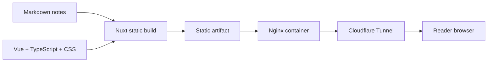
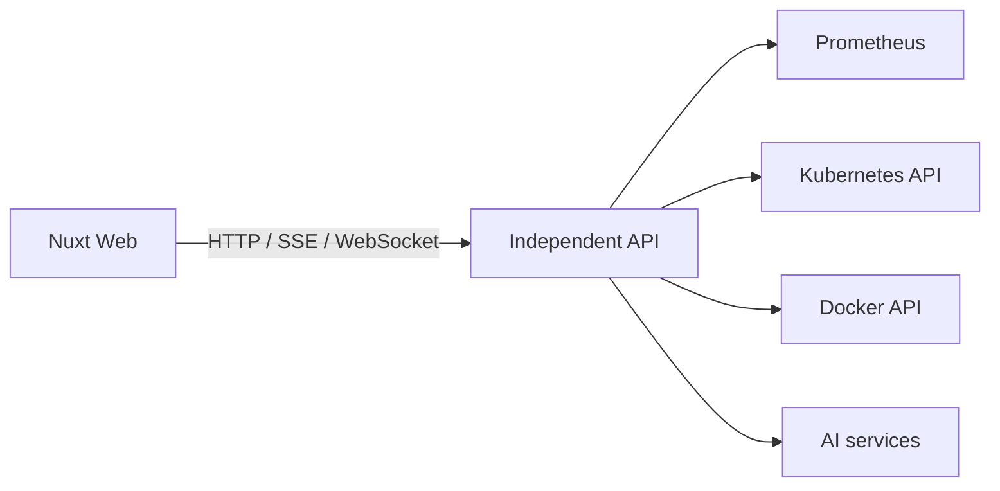

# Architecture overview

## Current system boundary

PBlue Lab v0.1 is one stateless web application. Nuxt turns source and Markdown into a static site during the build. Nginx serves the generated result. No request needs server-side application logic.



### Why static generation

The current content changes at deploy time, not per request. Static generation therefore removes a runtime Node process, avoids database and cache dependencies, makes rollback an artifact operation, and gives each page useful HTML before client JavaScript runs.

Nuxt remains valuable because it provides content collections, typed application code, route generation, component-based rendering, and a clear path to selectively add dynamic behavior later.

### Why Nginx at runtime

Nginx has one job here: serve immutable files and health endpoints. The multi-stage image keeps Node, pnpm, source files, and `node_modules` in the builder stage. The runtime image contains only Nginx, its configuration, and generated assets.

### Why the web application stays stateless

Any container instance can serve any request because there is no session or writable application data. This makes replacement, horizontal replicas, and Kubernetes rollouts predictable. Durable state, if introduced later, must live behind an explicit service boundary.

### Why there is no backend

The homepage, topic index, and blog are fully determined at build time. A backend would add deployment, security, monitoring, and failure modes without enabling a current user need.

## Separation of application and infrastructure

`apps/web` knows the public canonical URL and produces a web artifact. It does not know the host path, host port `8037`, server IP, Cloudflare token, or Tunnel credential. Those values belong to deployment configuration outside the application.

`infra/nginx` defines the container's HTTP behavior. `infra/k8s` defines how the immutable image is run and reached inside a cluster. Neither directory contains application content.

## Evolution triggers

### Introduce an independent API when

- pages need current system, Docker, Kubernetes, or Prometheus data;
- an AI demonstration must call model or agent services with protected credentials;
- long-running work, server-sent events, or WebSockets become a real requirement; or
- state must change independently from a web deploy.



The browser must never receive a Docker socket, Kubernetes administrator credential, privileged Prometheus endpoint, or model provider secret. The API authenticates, authorizes, validates, and reduces those capabilities.

### Extract shared packages when

At least two concrete applications consume the same stable component, schema, or client code and duplication is measurably harmful. Until then, keeping code inside `apps/web` gives it a clear owner and avoids premature versioning.

### Move from Docker to Kubernetes when

There is a real need to practice or operate declarative rollout, self-healing, multiple replicas, service discovery, or a broader group of services. A single static container does not require Kubernetes to be reliable; the included manifests are a standards-based learning and migration baseline.

## Observability path

The repository does not install Prometheus, Grafana, or OpenTelemetry in v0.1. The likely progression is:

```text
Web artifact → Docker runtime → Kubernetes workload
             → Prometheus signals → Grafana views
             → application metrics and AIOps experiments
```

Each addition should answer an existing operational question. Nginx access/error logs and health endpoints are sufficient for the current workload.
